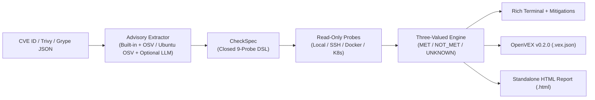

# notaffected

**From 10,000 noisy CVE alerts down to the 3 that actually matter — with deterministic proof and OpenVEX output for all the rest.**

Every week dozens of new CVEs are published, and AI-assisted research is finding them faster than ever. Traditional vulnerability scanners (Trivy, Grype, Qualys, Nessus) only check package versions: *"You have package X at version Y, therefore you are vulnerable."* They do not know whether the vulnerable code path or service can actually be triggered on your machine. It is like a smoke alarm that goes off every time you make toast: eventually you either panic or mute it.

`notaffected` bridges the gap between security advisories and the real runtime state of your Linux hosts, containers, and Kubernetes pods:

1. **Extracts attack preconditions** from advisories (built-in golden specs, OSV.dev / Ubuntu OSV records, kernel commit paths, and optional schema-validated LLM extraction).
2. **Runs deterministic, read-only probes** on your targets (local host, SSH fleet, Docker containers, or Kubernetes pods). **AI never decides the verdict and never runs shell commands** — only real system checks produce a decision, and uncertainty always resolves to `under_investigation`, never a false `not_affected`.
3. **Delivers actionable output:**
   - The short list of hosts that are **truly affected**, the exact temporary mitigation commands (`ufw`, `sysctl`, `modprobe -r`, `systemctl`) to run right now, and whether the vendor patch is in `-security` or still staged in `-proposed`.
   - For every unaffected host, **`not_affected` with deterministic proof** (e.g. module not loaded, service listening only on `127.0.0.1`, firewall default deny).
   - A standard **OpenVEX v0.2.0** file (`.vex.json`) that existing scanners (`trivy --vex`, Dependency-Track) consume to silence false positives automatically, plus an optional standalone **HTML audit report** (`--html`).

---

## Architecture



### Closed Set of 9 Read-Only Probes

| Probe Type | System Check | OpenVEX Justification (when `NOT_MET`) |
|---|---|---|
| `kernel_version_vulnerable` | `uname -r` + `dpkg --compare-versions` | `vulnerable_code_not_present` |
| `package_installed_vulnerable` | `dpkg-query -W` + `dpkg --compare-versions` | `component_not_present` / `vulnerable_code_not_present` |
| `kernel_module_loaded` | `/proc/modules` | `vulnerable_code_not_in_execute_path` |
| `sysctl_equals` | `sysctl -n <key>` | `inline_mitigations_already_exist` |
| `network_listener` | `ss -tulpnH` (loopback `127.0.0.0/8`, `::1`, `%lo` vs public) | `vulnerable_code_not_in_execute_path` |
| `firewall_allows_port` | `ufw status verbose` | `inline_mitigations_already_exist` |
| `systemd_service_active` | `systemctl is-active <unit>` | `vulnerable_code_not_in_execute_path` |
| `process_running` | `ps -eo comm,args --no-headers` | `vulnerable_code_not_in_execute_path` |
| `config_contains` | `cat <config_path>` (comment-aware regex match) | `inline_mitigations_already_exist` / `vulnerable_code_not_in_execute_path` |

---

## Installation

```bash
uv venv && uv pip install -e ".[dev]"
```

---

## Quick Start

### 1. Inspect extracted preconditions & mitigations for a CVE
```bash
notaffected spec CVE-2026-98432
```

### 2. Check the local machine or a 3-host simulated fleet
```bash
# Live check on your local Linux machine
notaffected check CVE-2026-98432 CVE-2024-47176 CVE-2022-47942 --host local

# Run against the built-in 3-host demo fleet (laptop, exposed server, patched DB)
notaffected check CVE-2026-98432 --demo-fleet --emit-vex vex.json --html report.html
```

### 3. Check remote SSH hosts, Docker containers, or Kubernetes pods
```bash
# SSH targets or YAML inventory
notaffected check CVE-2026-98432 --ssh ubuntu@10.0.0.10 -i hosts.yml

# Running Docker containers or Kubernetes pods
notaffected check CVE-2024-47176 --docker api-container --k8s prod/worker-pod-0
```

### 4. Filter an existing Trivy or Grype JSON scan report
```bash
notaffected filter fixtures/trivy_ubuntu_sample.json --host local --emit-vex vex.json --html report.html

# Feed the generated OpenVEX file back into Trivy to silence proven non-issues:
trivy rootfs --vex vex.json /
```

---

## License

MIT
