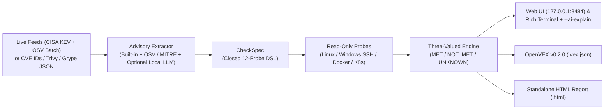

# notaffected

[](https://github.com/KatsaounisThanasis/notaffected/actions/workflows/ci.yml)
[](https://www.python.org/downloads/)
[](https://openvex.dev/)
[](LICENSE)

**From 10,000 noisy CVE alerts down to the 3 that actually matter — with deterministic proof and OpenVEX output for all the rest.**


Every week dozens of new CVEs are published, and AI-assisted research is finding them faster than ever. Traditional vulnerability scanners (Trivy, Grype, Qualys, Nessus) only check package versions: *"You have package X at version Y, therefore you are vulnerable."* They do not know whether the vulnerable code path or service can actually be triggered on your machine. It is like a smoke alarm that goes off every time you make toast: eventually you either panic or mute it.

`notaffected` bridges the gap between security advisories and the real runtime state of your Linux and Windows Server hosts, containers, and Kubernetes pods:

1. **Extracts attack preconditions** from advisories (built-in golden specs for Linux & Windows, OSV.dev / Ubuntu OSV records, kernel commit paths, and optional schema-validated multi-provider LLM extraction via Gemini, Claude, OpenAI, or Ollama).
2. **Runs deterministic, read-only probes** on your targets (local host, Linux/Windows SSH fleet, Docker containers, or Kubernetes pods). **AI never decides the verdict and never runs shell commands** — only real system checks produce a decision, and uncertainty always resolves to `under_investigation`, never a false `not_affected`.
3. **Delivers actionable output:**
   - The short list of hosts that are **truly affected**, the exact temporary mitigation commands (`ufw`, `sysctl`, `modprobe -r`, `systemctl`, or PowerShell `Set-ItemProperty` / `Stop-Service`) to run right now, live APT/KB patch status, and an optional **AI Operational Risk & Remediation Briefing** (`--ai-explain`).
   - For every unaffected host, **`not_affected` with deterministic proof** (e.g. module not loaded, service listening only on `127.0.0.1`, firewall default deny, or Windows Registry mitigation active).
   - A standard **OpenVEX v0.2.0** file (`.vex.json`) that existing scanners (`trivy --vex`, Dependency-Track) consume to silence false positives automatically, plus an optional standalone **HTML audit report** (`--html`).

---

## Architecture



### Closed Set of 12 Read-Only Probes (Linux & Windows Server)

| Probe Type | OS | System Check | OpenVEX Justification (when `NOT_MET`) |
|---|---|---|---|
| `kernel_version_vulnerable` | Linux | `uname -r` + `dpkg --compare-versions` | `vulnerable_code_not_present` |
| `package_installed_vulnerable` | Linux | `dpkg-query -W` + `dpkg --compare-versions` | `component_not_present` / `vulnerable_code_not_present` |
| `kernel_module_loaded` | Linux | `/proc/modules` | `vulnerable_code_not_in_execute_path` |
| `sysctl_equals` | Linux | `sysctl -n <key>` | `inline_mitigations_already_exist` |
| `network_listener` | Linux | `ss -tulpnH` (loopback `127.0.0.0/8`, `::1`, `%lo` vs public) | `vulnerable_code_not_in_execute_path` |
| `firewall_allows_port` | Linux | `ufw status verbose` | `inline_mitigations_already_exist` |
| `systemd_service_active` | Linux | `systemctl is-active <unit>` | `vulnerable_code_not_in_execute_path` |
| `process_running` | Linux / Windows | `ps -eo comm,args` / PowerShell `Get-Process` | `vulnerable_code_not_in_execute_path` |
| `config_contains` | Linux | `cat <config_path>` (comment-aware regex match) | `inline_mitigations_already_exist` / `vulnerable_code_not_in_execute_path` |
| `windows_build_vulnerable` | Windows | PowerShell `Get-HotFix` + `CurrentBuildNumber.UBR` | `vulnerable_code_not_present` |
| `windows_registry_equals` | Windows | PowerShell `Get-ItemProperty` (`HKLM:\` / `HKCU:\`) | `inline_mitigations_already_exist` |
| `windows_service_active` | Windows | PowerShell `(Get-Service -Name <svc>).Status` | `vulnerable_code_not_in_execute_path` |

---

## Installation

```bash
uv venv && uv pip install -e ".[dev]"
```

---

## Quick Start

### 1. Launch the Local Web Dashboard (`notaffected ui`)
```bash
notaffected ui --port 8484
# Open http://127.0.0.1:8484 in your browser
```
From the Web Dashboard you can:
- Auto-discover running Docker containers, load `inventory.yaml`, select a single custom Docker/SSH target, or inspect the simulated Linux + Windows Server fleet.
- Run **Auto-Scan** (combines built-in rules + live OSV `/v1/querybatch` package queries + live CISA KEV actively exploited CVEs), check specific CVE IDs, or upload a **Trivy / Grype JSON report**.
- Execute allowlisted temporary mitigations directly from the UI via **Run Mitigation** (with automatic host re-verification that flips `AFFECTED` rows to `NOT AFFECTED` live), reset the lab via **Reset Lab / Demo**, and download **OpenVEX v0.2.0 (`.vex.json`)**, **Audit JSON**, or a **Standalone HTML Report**.

### 2. Zero-Argument Auto-Scan & Fleet Initialization
```bash
# Auto-generate an inventory file (discovering running Docker containers)
notaffected init --discover-docker -o inventory.yaml

# Scan your fleet against built-in rules, live OSV package batch API, and CISA KEV feed
notaffected scan -i inventory.yaml --emit-vex vex.json --html report.html
```

### 3. Inspect extracted preconditions & mitigations for any CVE
```bash
notaffected spec CVE-2026-98432
notaffected spec CVE-2024-30080 --llm
```

### 4. Check specific CVEs across local, SSH, Docker, or Kubernetes targets
```bash
# Live check on your local Linux machine
notaffected check CVE-2026-98432 CVE-2024-47176 CVE-2022-47942 --host local

# Run against the built-in 5-host mixed Linux + Windows Server demo fleet
notaffected check CVE-2026-98432 CVE-2024-38063 CVE-2021-34527 --demo-fleet --ai-explain --emit-vex vex.json --html report.html

# Linux and Windows OpenSSH targets or running Docker / Kubernetes workloads
notaffected check CVE-2024-6387 CVE-2024-38063 --ssh ubuntu@10.0.0.10 --win-ssh Administrator@10.0.1.50
notaffected check CVE-2024-6387 --docker lab-ssh-vuln --win-docker lab-win-dc01 --k8s prod/worker-pod-0
```

### 5. Filter an existing Trivy or Grype JSON scan report
```bash
notaffected filter examples/trivy-scan.json -i lab/inventory.yaml --emit-vex vex.json --html report.html

# Feed the generated OpenVEX file back into Trivy to silence proven non-issues:
trivy rootfs --vex vex.json /
```

### 6. Local Docker Simulation Lab (`lab/`)
Spin up 4 ultra-lightweight containers (< 2 MB RAM total, 0% idle CPU) simulating vulnerable & mitigated Linux (`CVE-2024-6387`) and Windows Server (`CVE-2024-38063`, `CVE-2021-34527`) targets:
```bash
./lab/setup_lab.sh
notaffected scan -i lab/inventory.yaml
./lab/teardown_lab.sh
```

### 7. Optional Local-First AI Configuration
By default, `--llm` and `--ai-explain` target **local Ollama (`127.0.0.1:11434`)** so zero data leaves your machine unless an external provider (`NOTAFFECTED_LLM_PROVIDER=claude-cli|agy-cli|gemini|anthropic|openai`) or API key is explicitly configured.

---

## License

MIT
