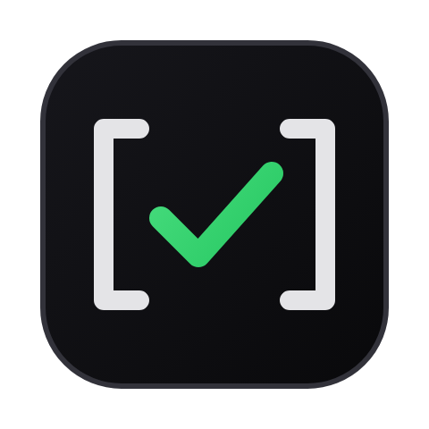
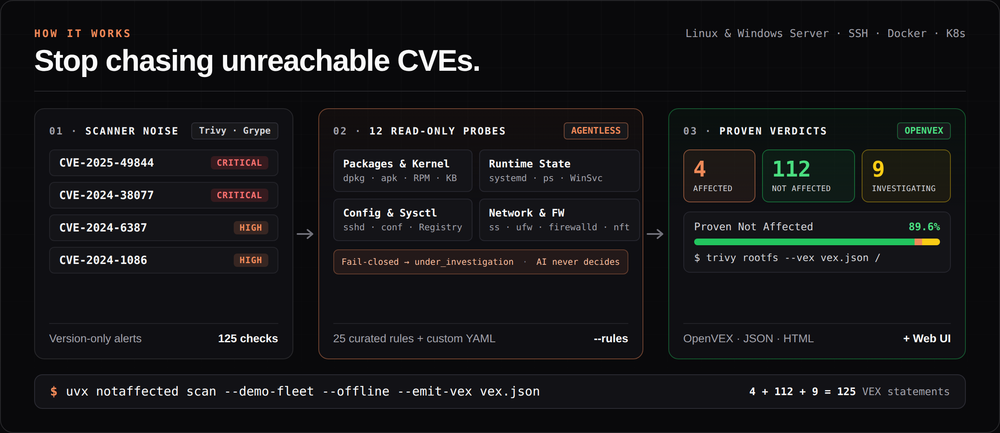

<div align="center">



# notaffected

**Prove whether CVEs actually affect your Linux & Windows Server hosts with deterministic proof and OpenVEX v0.2.0.**

[](https://github.com/KatsaounisThanasis/notaffected/actions/workflows/ci.yml)
[](https://pypi.org/project/notaffected/)
[](https://www.python.org/downloads/)
[](https://openvex.dev/)
[](https://github.com/KatsaounisThanasis/notaffected/blob/main/LICENSE)

[Quick Start](#quick-start) · [Reference & Probes](https://github.com/KatsaounisThanasis/notaffected/blob/main/docs/reference.md) · [Security](https://github.com/KatsaounisThanasis/notaffected/blob/main/SECURITY.md) · [Changelog](https://github.com/KatsaounisThanasis/notaffected/blob/main/CHANGELOG.md)

<br/>



</div>

<br/>

Traditional vulnerability scanners (Trivy, Grype, Qualys, Nessus) only check package versions. They do not know whether the vulnerable module, service, port, or registry path is actually reachable on your host.

`notaffected` turns CVE alerts into deterministic runtime verdicts across Linux and Windows Server (local, SSH, Docker, Kubernetes):

- **Advisory preconditions:** 25 curated Linux & Windows Server rules plus live OSV.dev, Red Hat Security Data API, Microsoft MSRC CVRF, MITRE CVE v5, CISA KEV, custom YAML rules (`--rules`), and an optional bring-your-own-model advisor.
- **12 read-only, fail-closed probes:** Checks kernel/package versions, loaded modules, `sysctl`, `ss` listeners, `ufw`/`firewalld`/`nftables`, `systemd`, processes, configs, and Windows builds/registry/services. Any ambiguity resolves to `under_investigation`; AI never decides verdicts or runs shell commands ([Security model](https://github.com/KatsaounisThanasis/notaffected/blob/main/SECURITY.md)).
- **Actionable output:** Pinpoints truly `affected` hosts with temporary mitigation commands, proves `not_affected` hosts, and exports standard **OpenVEX v0.2.0** (`.vex.json`, ready for `trivy --vex`) and standalone **HTML audit reports** (`--html`).

---

## Installation

```bash
# Instant run without installing globally (uv)
uvx notaffected ui

# Isolated CLI install (pipx) or standard pip
pipx install notaffected
pip install notaffected
```

From source: `git clone https://github.com/KatsaounisThanasis/notaffected.git && cd notaffected && uv venv && uv pip install -e ".[dev]"`

---

## Quick Start

### 1. Local Web Dashboard

```bash
notaffected ui --port 8484
# Open http://127.0.0.1:8484
```


Discover Docker containers, load `inventory.yaml`, run Auto-Scan or upload a Trivy/Grype JSON report, test lab-only mitigations, and export OpenVEX v0.2.0 or HTML audit reports.

### 2. Zero-Argument Auto-Scan

```bash
# Try immediately with the built-in 5-host Linux + Windows Server demo fleet (100% offline)
notaffected scan --demo-fleet --offline --emit-vex demo.vex.json --html demo.html

# Or discover Docker targets and scan a real fleet
notaffected init --discover-docker -o inventory.yaml
notaffected scan -i inventory.yaml --emit-vex vex.json --html report.html
```

```text
Auto-Scan Feed: 25 built-in rules | 0 live OSV package CVEs | 0 live CISA KEV CVEs
AFFECTED (4)            prod-edge-api-01 (CVE-2026-98432, CVE-2024-6387)
                        win-dc-01        (CVE-2024-38063, CVE-2021-34527)
NOT AFFECTED (112)      89.6% false-positive noise cut with OpenVEX v0.2.0 proof (9 under_investigation)
OpenVEX v0.2.0 written to: demo.vex.json (125 statement(s))
```

### 3. Check Specific CVEs or Filter Trivy / Grype Reports

```bash
# Inspect preconditions & mitigations for any CVE
notaffected spec CVE-2024-6387

# Check local, SSH (Linux/Windows), Docker, or Kubernetes targets
notaffected check CVE-2024-6387 CVE-2024-47176 --host local
notaffected check CVE-2024-6387 CVE-2024-38063 --ssh ubuntu@10.0.0.10 --win-ssh Administrator@10.0.1.50
notaffected check CVE-2024-6387 --docker lab-ssh-vuln --k8s prod/worker-pod-0

# Filter a Trivy/Grype JSON scan and feed the OpenVEX output back into Trivy (one VEX per host)
notaffected filter examples/trivy-scan.json -i lab/inventory.yaml --emit-vex vex.json --html report.html
trivy rootfs --vex vex.json /
```

---

## Documentation

- **[Reference & Probes (`docs/reference.md`)](https://github.com/KatsaounisThanasis/notaffected/blob/main/docs/reference.md):** Architecture diagram, all 12 read-only probes & OpenVEX justifications, custom YAML `--rules`, 4-container Docker simulation lab (`lab/`), Web UI safety controls, and optional AI advisor (BYOM) setup.
- **[Security (`SECURITY.md`)](https://github.com/KatsaounisThanasis/notaffected/blob/main/SECURITY.md):** Threat model, fail-closed guarantees, and vulnerability reporting.
- **[Changelog (`CHANGELOG.md`)](https://github.com/KatsaounisThanasis/notaffected/blob/main/CHANGELOG.md):** Release history.

## License

MIT
