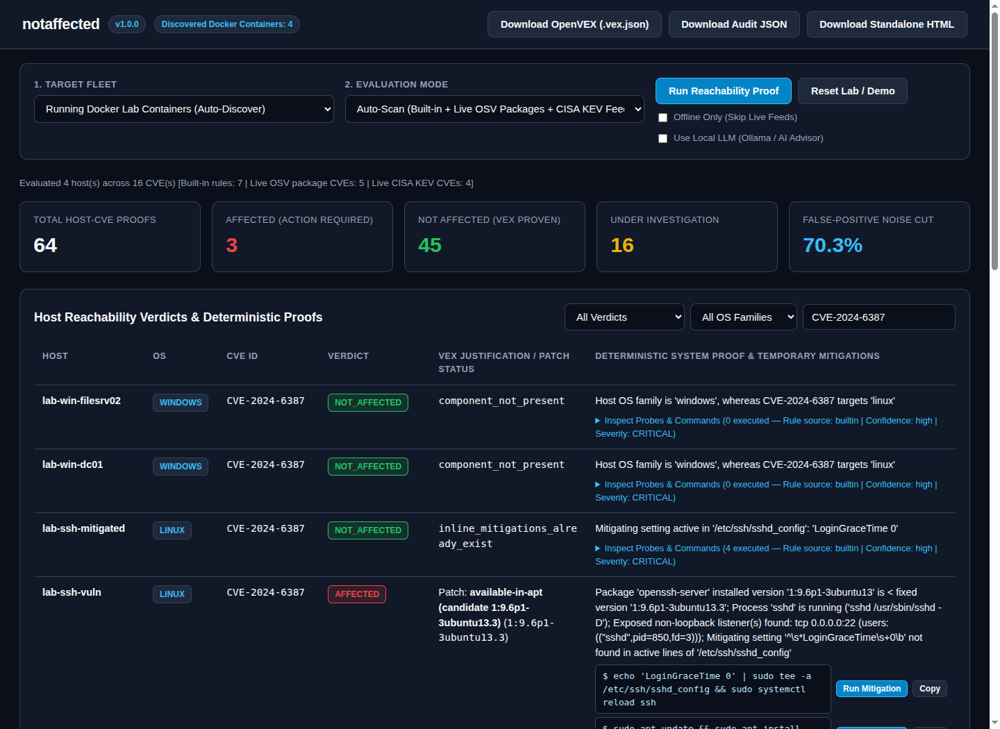
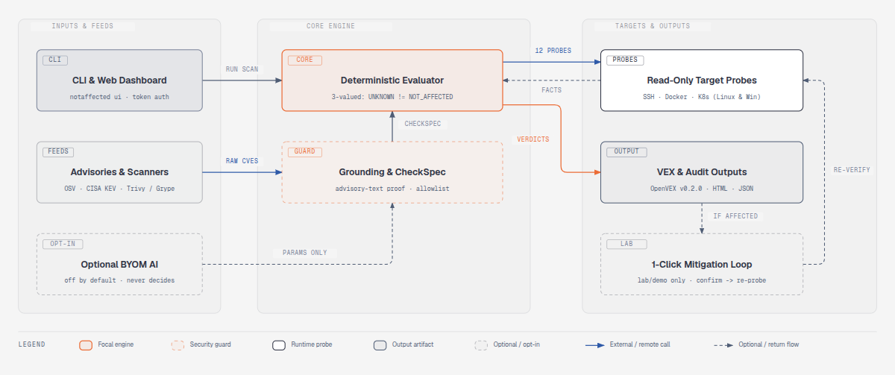

# notaffected

[](https://github.com/KatsaounisThanasis/notaffected/actions/workflows/ci.yml)
[](https://pypi.org/project/notaffected/)
[](https://www.python.org/downloads/)
[](https://openvex.dev/)
[](https://github.com/KatsaounisThanasis/notaffected/blob/main/LICENSE)

**From 10,000 noisy CVE alerts down to the 3 that actually matter — with deterministic proof and OpenVEX output for all the rest.**



Every week dozens of new CVEs are published, and AI-assisted research is finding them faster than ever. Traditional vulnerability scanners (Trivy, Grype, Qualys, Nessus) only check package versions: *"You have package X at version Y, therefore you are vulnerable."* They do not know whether the vulnerable code path or service can actually be triggered on your machine. It is like a smoke alarm that goes off every time you make toast: eventually you either panic or mute it.

`notaffected` bridges the gap between security advisories and the real runtime state of your Linux and Windows Server hosts, containers, and Kubernetes pods:

1. **Extracts attack preconditions** from official advisories (built-in golden specs for Linux & Windows, OSV.dev / Ubuntu / Debian / Alpine OSV records, Red Hat Security Data API, Microsoft MSRC CVRF v3.0, MITRE CVE v5, CISA KEV, and optional schema-validated LLM extraction with any provider and model you configure, local or hosted).
2. **Runs deterministic, read-only probes** on your targets (local host, Linux/Windows SSH fleet, Docker containers, or Kubernetes pods). **AI never decides the verdict and never runs shell commands**: the optional LLM may only propose parameters for the closed probe set, each one must be named in the advisory, it never sets the OS family or the VEX justification, and a `NOT_MET` from an LLM-proposed or keyword-heuristic check never yields `not_affected` on its own. `not_affected` needs a `NOT_MET` from a curated or structured-data check (or a probe-confirmed OS mismatch); every check that cannot compare, see or confirm something resolves to `under_investigation`.
3. **Delivers actionable output:**
   - The short list of hosts that are **truly affected**, the exact temporary mitigation commands (`ufw`, `sysctl`, `modprobe -r`, `systemctl`, or PowerShell `Set-ItemProperty` / `Stop-Service`) to run right now, live APT patch status on Linux (`apt-cache policy`; Windows KB status comes from the built-in spec, not a live query), and an optional **AI Operational Risk & Remediation Briefing** (`--ai-explain`).
   - For every unaffected host, **`not_affected` with deterministic proof** (e.g. kernel module blocked from loading, service listening only on `127.0.0.1`, firewall default deny, or Windows Registry mitigation active).
   - A standard **OpenVEX v0.2.0** file (`.vex.json`). Statements about an installed package carry its Package URL (e.g. `pkg:deb/ubuntu/openssh-server@9.6p1-3ubuntu13.3?epoch=1`), which is what `trivy --vex` matches on: as the product when the document covers one host, as a subcomponent of the host when it covers a fleet. For Trivy, emit one VEX document per host. Dependency-Track does not import OpenVEX yet ([DependencyTrack/dependency-track#7094](https://github.com/DependencyTrack/dependency-track/issues/7094)). An optional standalone **HTML audit report** (`--html`) is also available.

---

## Architecture



### Closed Set of 12 Read-Only Probes (Linux & Windows Server)

| Probe Type | OS | System Check | OpenVEX Justification (when `NOT_MET`) |
|---|---|---|---|
| `kernel_version_vulnerable` | Linux | `uname -r` + `dpkg --compare-versions`, only against fix data for the kernel's own track (line + flavour); a curated `mainline_from` line counts any kernel at or above it as fixed; other tracks are `UNKNOWN` | `vulnerable_code_not_present` |
| `package_installed_vulnerable` | Linux | `dpkg-query -W` (`apk info` / `rpm -q` when dpkg is absent) + comparator (`dpkg --compare-versions` / `apk version -t` / native RPM EVR `rpmvercmp`), against the fix for the host's own distro release; cross-distro or unlisted releases are `UNKNOWN` | `component_not_present` / `vulnerable_code_not_present` |
| `kernel_module_loaded` | Linux | `/proc/modules`; "not loaded" counts only when loading is blocked (`modprobe -c` `install <mod> /bin/false`, or `kernel.modules_disabled=1`) | `vulnerable_code_not_in_execute_path` |
| `sysctl_equals` | Linux | `sysctl -n <key>` | `inline_mitigations_already_exist` |
| `network_listener` | Linux | `ss -tulpnH` (loopback `127.0.0.0/8`, `::1`, `%lo` vs public); a process filter needs visible process names (root) | `vulnerable_code_not_in_execute_path` |
| `firewall_allows_port` | Linux | `ufw status verbose`, falling back to `firewall-cmd --list-all` (firewalld) and `nft list ruleset` (nftables); ambiguous rules, unknown services/profiles or a Docker bridge are `UNKNOWN` | `inline_mitigations_already_exist` |
| `systemd_service_active` | Linux | `systemctl is-active <unit>` + `LoadState` + its `.socket` unit | `vulnerable_code_not_in_execute_path` |
| `process_running` | Linux / Windows | `ps -eo comm,args` / PowerShell `Get-Process` | `vulnerable_code_not_in_execute_path` |
| `config_contains` | Linux | `cat <config_path>` (regex on lines that are not `#` / `;` comments; for sshd, `sshd -T` or the first occurrence of the directive) | `inline_mitigations_already_exist` / `vulnerable_code_not_in_execute_path` |
| `windows_build_vulnerable` | Windows | PowerShell `Get-HotFix` + `CurrentBuildNumber.UBR` | `vulnerable_code_not_present` |
| `windows_registry_equals` | Windows | PowerShell `Get-ItemProperty` (`HKLM:\` / `HKCU:\`) | `inline_mitigations_already_exist` |
| `windows_service_active` | Windows | PowerShell `(Get-Service -Name <svc>).Status` | `vulnerable_code_not_in_execute_path` |

The justification column shows the default per probe. Built-in specs set it per check; LLM-proposed checks always use the per-probe default, and their `NOT_MET` never yields `not_affected` on its own.

---

## Installation

Run without installing globally via `uvx` or install with `pipx` / `pip`:

```bash
# Instant run (uv)
uvx notaffected ui

# Isolated CLI install (pipx)
pipx install notaffected

# Standard pip install
pip install notaffected
```

For local development from source:

```bash
git clone https://github.com/KatsaounisThanasis/notaffected.git
cd notaffected
uv venv && uv pip install -e ".[dev]"
```

---

## Quick Start

### 1. Launch the Local Web Dashboard (`notaffected ui`)
```bash
notaffected ui --port 8484
# Open http://127.0.0.1:8484 in your browser
```
From the Web Dashboard you can:
- Auto-discover running Docker containers, load `inventory.yaml`, select a single custom Docker/SSH target, or inspect the simulated Linux + Windows Server fleet.
- Run **Auto-Scan** (combines built-in rules + live OSV `/v1/querybatch` queries for a fixed watch list of 7 packages, keeping up to 6 OSV CVEs, + up to 4 CISA KEV actively exploited CVEs), check specific CVE IDs, or upload a **Trivy / Grype JSON report**.
- Try allowlisted temporary mitigations on the lab via **Run Mitigation**, reset the lab via **Reset Lab / Demo**, and download **OpenVEX v0.2.0 (`.vex.json`)**, **Audit JSON**, or a **Standalone HTML Report**. Run Mitigation works only on the simulated fleet (where the row flip is simulated) and on Docker containers labelled `notaffected.lab=true`; it refuses local and SSH hosts and any container without that label (also when it comes from an inventory file), because the tool's design is to never change real target hosts. Apply mitigations on real hosts yourself.
- Every dashboard POST needs the per-process token embedded in the page, and `notaffected ui` refuses a non-loopback `--bind` unless you pass `--allow-remote` **and** set `NOTAFFECTED_REMOTE_TOKEN` (at least 16 chars, never embedded in unauthenticated HTML).

### 2. Zero-Argument Auto-Scan & Fleet Initialization
```bash
# Auto-generate an inventory file (discovering running Docker containers)
notaffected init --discover-docker -o inventory.yaml

# Scan your fleet against built-in rules, live OSV package batch API, and CISA KEV feed
notaffected scan -i inventory.yaml --emit-vex vex.json --html report.html

# Try immediately with the built-in 5-host Linux + Windows Server demo fleet (100% offline)
notaffected scan --demo-fleet --offline --emit-vex demo.vex.json --html demo.html
```

Example CLI summary on the mixed 5-host demo fleet (35 scanner-equivalent alerts cut down to 4 real exposures):
```text
Auto-Scan Feed: 7 built-in rules | 0 live OSV package CVEs | 0 live CISA KEV CVEs
AFFECTED (4)            prod-edge-api-01 (CVE-2026-98432, CVE-2024-6387)
                        win-dc-01        (CVE-2024-38063, CVE-2021-34527)
NOT AFFECTED (31)       88.6% false-positive noise cut with OpenVEX v0.2.0 proof
OpenVEX v0.2.0 written to: demo.vex.json (35 statement(s))
```

### 3. Inspect extracted preconditions & mitigations for any CVE
```bash
notaffected spec CVE-2024-6387
notaffected spec CVE-2024-30080 --llm
```

### 4. Check specific CVEs across local, SSH, Docker, or Kubernetes targets
```bash
# Live check on your local Linux machine
notaffected check CVE-2024-6387 CVE-2024-47176 CVE-2023-32233 --host local

# Run against the built-in 5-host mixed Linux + Windows Server demo fleet
notaffected check CVE-2024-6387 CVE-2024-38063 CVE-2021-34527 --demo-fleet --ai-explain --emit-vex vex.json --html report.html

# Linux and Windows OpenSSH targets or running Docker / Kubernetes workloads
notaffected check CVE-2024-6387 CVE-2024-38063 --ssh ubuntu@10.0.0.10 --win-ssh Administrator@10.0.1.50
notaffected check CVE-2024-6387 --docker lab-ssh-vuln --win-docker lab-win-dc01 --k8s prod/worker-pod-0
```

### 5. Filter an existing Trivy or Grype JSON scan report
```bash
notaffected filter examples/trivy-scan.json -i lab/inventory.yaml --emit-vex vex.json --html report.html

# Feed the generated OpenVEX file back into Trivy to silence proven non-issues
# (one host per VEX document, so package PURLs are the products Trivy matches):
trivy rootfs --vex vex.json /
```

### 6. Custom YAML CheckSpec Rules (`--rules`)
Author your own deterministic rules (or override built-in specs) in YAML without editing Python. Pass a file or a directory of `.yaml`/`.yml` files to `spec`, `check`, `filter`, `scan`, or `ui` (see `examples/custom-rule.yaml`):
```bash
notaffected spec CVE-2026-40123 --rules examples/custom-rule.yaml
notaffected check CVE-2026-40123 --demo-fleet --rules examples/custom-rule.yaml --offline
notaffected scan --demo-fleet --offline --rules ./my-rules-dir/
notaffected ui --rules examples/custom-rule.yaml
```
Every custom rule is strictly validated against the closed set of 12 read-only probes, per-OS probe allowlists, required/optional parameter names, and OpenVEX justification values.

### 7. Local Docker Simulation Lab (`lab/`)
Spin up 4 ultra-lightweight containers (< 2 MB RAM total, 0% idle CPU) simulating vulnerable & mitigated Linux (`CVE-2024-6387`) and Windows Server (`CVE-2024-38063`, `CVE-2021-34527`) targets:
```bash
./lab/setup_lab.sh
notaffected scan -i lab/inventory.yaml
./lab/teardown_lab.sh
```

### 8. Optional AI Advisor (bring your own model)
The AI advisor is off until you configure it: with nothing set, `--llm` and `--ai-explain` fall back to deterministic output and nothing is sent to any model. Pick any provider and model you prefer, local or hosted:

| Provider | Set | Model |
|---|---|---|
| Any OpenAI-compatible server (vLLM, LM Studio, llama.cpp, LiteLLM, ...) | `NOTAFFECTED_LLM_URL=http://host:port/v1/chat/completions` (+ `NOTAFFECTED_LLM_API_KEY` if it needs one; `OPENAI_API_KEY` is never sent to it) | `NOTAFFECTED_LLM_MODEL` |
| Ollama | `NOTAFFECTED_LLM_PROVIDER=ollama` (or `NOTAFFECTED_LLM_URL=http://host:11434/api/generate`) | `NOTAFFECTED_LLM_MODEL` |
| OpenAI | `OPENAI_API_KEY` | `NOTAFFECTED_LLM_MODEL` |
| Anthropic | `ANTHROPIC_API_KEY` | `NOTAFFECTED_LLM_MODEL` |
| Google Gemini | `GEMINI_API_KEY` or `GOOGLE_API_KEY` | `NOTAFFECTED_LLM_MODEL` |
| `claude` / `agy` CLI | `NOTAFFECTED_LLM_PROVIDER=claude-cli` or `agy-cli` | the CLI's default, or `NOTAFFECTED_LLM_MODEL` |

`NOTAFFECTED_LLM_PROVIDER` overrides auto-detection; an unknown value turns the advisor off instead of guessing. Without it, a key picks the provider only when keys for exactly one provider are set. There is no built-in default model, so a key alone does not start sending advisory text anywhere. The dashboard shows the provider, the model and whether the endpoint is on this machine ("local", even if it is a proxy that forwards to a hosted API) or external, or "AI: not configured" with the reason. Whatever the model, it only proposes probe parameters: verdicts stay deterministic.

---

## License

MIT
