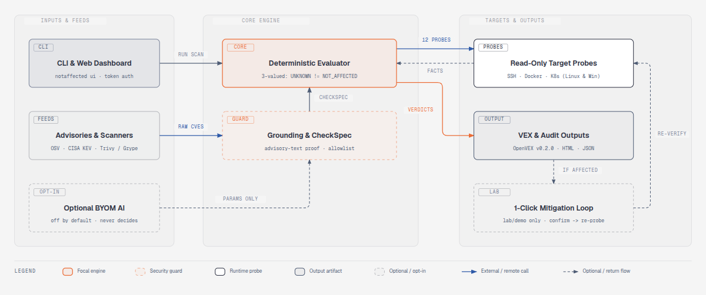

# notaffected Reference

Detailed architecture, probe specifications, custom YAML rules, local Docker lab, Web UI safety model, and optional AI advisor configuration.

---

## Architecture



### Closed Set of 12 Read-Only Probes (Linux & Windows Server)

| Probe Type | OS | System Check | OpenVEX Justification (when `NOT_MET`) |
|---|---|---|---|
| `kernel_version_vulnerable` | Linux | `uname -r` + `dpkg --compare-versions`, only against fix data for the kernel's own track (line + flavour); a curated `mainline_from` line counts any kernel at or above it as fixed; other tracks are `UNKNOWN` | `vulnerable_code_not_present` |
| `package_installed_vulnerable` | Linux | `dpkg-query -W` (`apk info` / `rpm -q` when dpkg is absent) + comparator (`dpkg --compare-versions` / `apk version -t` / native RPM EVR `rpmvercmp`), against the fix for the host's own distro release; cross-distro or unlisted releases are `UNKNOWN` | `component_not_present` / `vulnerable_code_not_present` |
| `kernel_module_loaded` | Linux | `/proc/modules`; "not loaded" counts only when loading is blocked (`modprobe -c` `install <mod> /bin/false`, or `kernel.modules_disabled=1`) | `vulnerable_code_not_in_execute_path` |
| `sysctl_equals` | Linux | `sysctl -n <key>` | `inline_mitigations_already_exist` |
| `network_listener` | Linux | `ss -tulpnH` (loopback `127.0.0.0/8`, `::1`, `%lo` vs public); a process filter needs visible process names (root) | `vulnerable_code_not_in_execute_path` |
| `firewall_allows_port` | Linux | `ufw status verbose`, falling back to `firewall-cmd --list-all` (firewalld) and `nft list ruleset` (nftables); ambiguous rules, unknown services/profiles or a Docker bridge are `UNKNOWN` | `inline_mitigations_already_exist` |
| `systemd_service_active` | Linux | `systemctl is-active <unit>` + `LoadState` + its `.socket` unit | `vulnerable_code_not_in_execute_path` |
| `process_running` | Linux / Windows | `ps -eo comm,args` / PowerShell `Get-Process` | `vulnerable_code_not_in_execute_path` |
| `config_contains` | Linux | `cat <config_path>` (regex on lines that are not `#` / `;` comments; for sshd, `sshd -T` or the first occurrence of the directive) | `inline_mitigations_already_exist` / `vulnerable_code_not_in_execute_path` |
| `windows_build_vulnerable` | Windows | PowerShell `Get-HotFix` + `CurrentBuildNumber.UBR` | `vulnerable_code_not_present` |
| `windows_registry_equals` | Windows | PowerShell `Get-ItemProperty` (`HKLM:\` / `HKCU:\`) | `inline_mitigations_already_exist` |
| `windows_service_active` | Windows | PowerShell `(Get-Service -Name <svc>).Status` | `vulnerable_code_not_in_execute_path` |

The justification column shows the default per probe. Built-in specs set it per check; LLM-proposed checks always use the per-probe default, and their `NOT_MET` never yields `not_affected` on its own.

---

## Advisory Sources & Fail-Closed Verdict Rules

- **Sources:** Built-in curated rules for Linux & Windows Server, OSV.dev / Ubuntu / Debian / Alpine OSV records, Red Hat Security Data API, Microsoft MSRC CVRF v3.0, MITRE CVE v5, CISA KEV, and optional schema-validated LLM extraction.
- **Fail-closed guarantee:** AI never decides the verdict and never runs shell commands. The optional LLM may only propose parameters for the closed probe set, each one must be named in the advisory, it never sets the OS family or the VEX justification, and a `NOT_MET` from an LLM-proposed or keyword-heuristic check never yields `not_affected` on its own. `not_affected` requires a `NOT_MET` from a curated or structured-data check (or a probe-confirmed OS mismatch). Every check that cannot compare, see, or confirm something resolves to `under_investigation`. See [SECURITY.md](../SECURITY.md) for the full threat model.
- **OpenVEX v0.2.0 & Trivy:** Statements about an installed package carry its Package URL (e.g. `pkg:deb/ubuntu/openssh-server@9.6p1-3ubuntu13.3?epoch=1`), which `trivy --vex` matches on: as the product when the document covers one host, or as a subcomponent of the host when it covers a fleet. For Trivy, emit one VEX document per host. Dependency-Track does not import OpenVEX yet ([DependencyTrack/dependency-track#7094](https://github.com/DependencyTrack/dependency-track/issues/7094)).
- **Patch & Mitigation Info:** Live APT patch status is queried on Linux (`apt-cache policy`); Windows KB status comes from the built-in spec rather than a live query.

---

## Web Dashboard Details

- **Auto-Scan:** Combines built-in rules + live OSV `/v1/querybatch` queries for a fixed watch list of 7 packages (keeping up to 6 OSV CVEs) + up to 4 CISA KEV actively exploited CVEs.
- **Lab-only mitigations:** **Run Mitigation** works only on the simulated fleet (where the row flip is simulated) and on Docker containers labelled `notaffected.lab=true`. It refuses local hosts, SSH hosts, and any container without that label (including those loaded from an inventory file), so real target hosts are never modified.
- **Authentication & binding:** Every dashboard `POST` requires the per-process token embedded in the page, and `notaffected ui` refuses a non-loopback `--bind` unless you pass `--allow-remote` **and** set `NOTAFFECTED_REMOTE_TOKEN` (at least 16 chars, never embedded in unauthenticated HTML).

---

## Custom YAML CheckSpec Rules (`--rules`)

Author your own deterministic rules (or override built-in specs) in YAML without editing Python. Pass a file or a directory of `.yaml`/`.yml` files to `spec`, `check`, `filter`, `scan`, or `ui` (see [examples/custom-rule.yaml](../examples/custom-rule.yaml)):

```bash
notaffected spec CVE-2026-40123 --rules examples/custom-rule.yaml
notaffected check CVE-2026-40123 --demo-fleet --rules examples/custom-rule.yaml --offline
notaffected scan --demo-fleet --offline --rules ./my-rules-dir/
notaffected ui --rules examples/custom-rule.yaml
```

Every custom rule is strictly validated against the closed set of 12 read-only probes, per-OS probe allowlists, required/optional parameter names, and OpenVEX justification values.

---

## Local Docker Simulation Lab (`lab/`)

Spin up 4 ultra-lightweight containers (< 2 MB RAM total, 0% idle CPU) simulating vulnerable & mitigated Linux (`CVE-2024-6387`) and Windows Server (`CVE-2024-38063`, `CVE-2021-34527`) targets:

```bash
./lab/setup_lab.sh
notaffected scan -i lab/inventory.yaml
./lab/teardown_lab.sh
```

---

## Optional AI Advisor (Bring Your Own Model)

The AI advisor is off until you configure it: with nothing set, `--llm` and `--ai-explain` fall back to deterministic output and nothing is sent to any model. Pick any provider and model you prefer, local or hosted:

| Provider | Set | Model |
|---|---|---|
| Any OpenAI-compatible server (vLLM, LM Studio, llama.cpp, LiteLLM, ...) | `NOTAFFECTED_LLM_URL=http://host:port/v1/chat/completions` (+ `NOTAFFECTED_LLM_API_KEY` if it needs one; `OPENAI_API_KEY` is never sent to it) | `NOTAFFECTED_LLM_MODEL` |
| Ollama | `NOTAFFECTED_LLM_PROVIDER=ollama` (or `NOTAFFECTED_LLM_URL=http://host:11434/api/generate`) | `NOTAFFECTED_LLM_MODEL` |
| OpenAI | `OPENAI_API_KEY` | `NOTAFFECTED_LLM_MODEL` |
| Anthropic | `ANTHROPIC_API_KEY` | `NOTAFFECTED_LLM_MODEL` |
| Google Gemini | `GEMINI_API_KEY` or `GOOGLE_API_KEY` | `NOTAFFECTED_LLM_MODEL` |
| `claude` / `agy` CLI | `NOTAFFECTED_LLM_PROVIDER=claude-cli` or `agy-cli` | the CLI's default, or `NOTAFFECTED_LLM_MODEL` |

`NOTAFFECTED_LLM_PROVIDER` overrides auto-detection; an unknown value turns the advisor off instead of guessing. Without it, a key picks the provider only when keys for exactly one provider are set. There is no built-in default model, so a key alone does not start sending advisory text anywhere. The dashboard shows the provider, the model, and whether the endpoint is on this machine ("local", even if it is a proxy that forwards to a hosted API) or external, or "AI: not configured" with the reason. Whatever the model, it only proposes probe parameters: verdicts stay deterministic.
